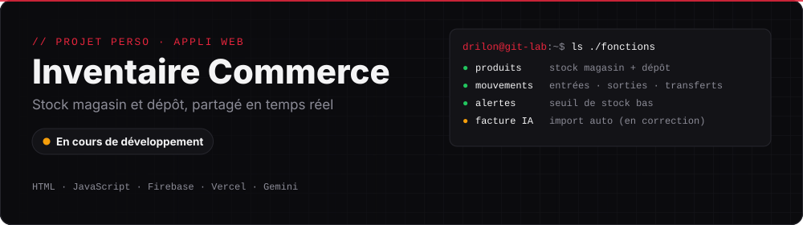
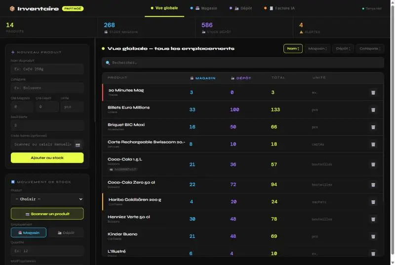
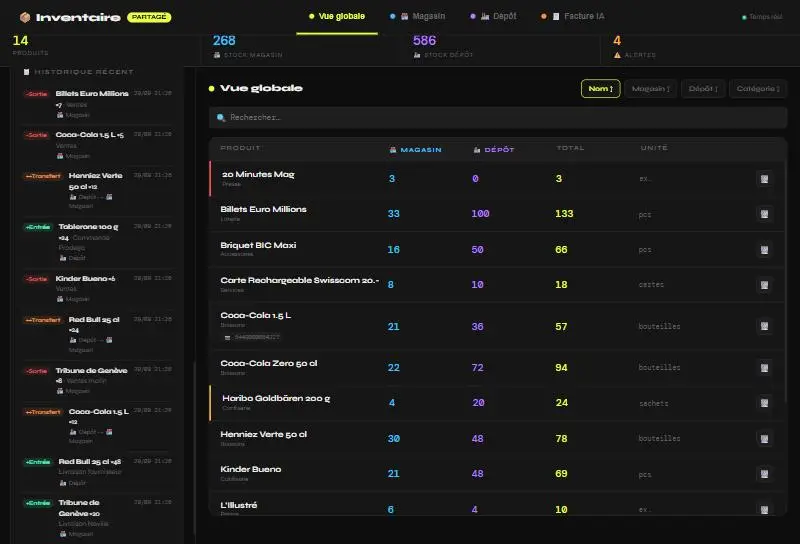
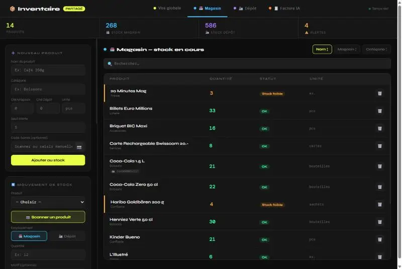
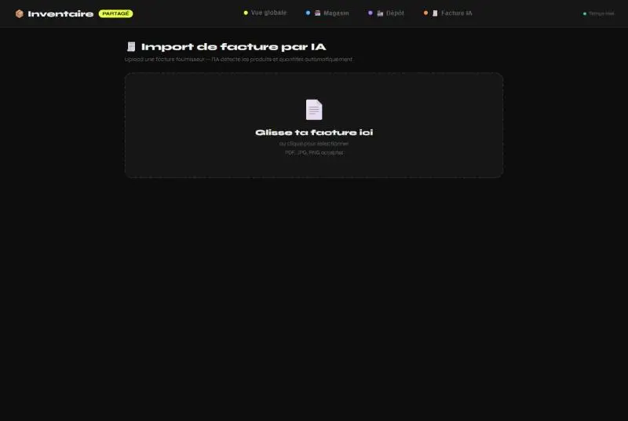
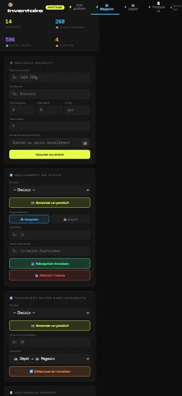

  
  
  
  

# Inventaire Commerce

Une appli web que j'ai faite pour gérer le stock d'un commerce de type tabac-journaux, avec un magasin et un dépôt.

J'ai travaillé 3 ans dans ce genre de commerce. L'idée : savoir à tout moment ce qu'il reste au magasin et au dépôt, avec un outil simple que plusieurs personnes peuvent utiliser en même temps depuis leur téléphone.

> 🔄 **En cours.** La gestion du stock fonctionne. L'import de facture par IA est encore en correction.

---

## Ce que fait l'appli

| Fonction | Détail |
|---|---|
| **Stock sur 2 emplacements** | Chaque produit a une quantité au magasin et une au dépôt |
| **Mouvements** | Réception de livraison, retrait / vente, avec un motif |
| **Transferts** | Dépôt → magasin ou l'inverse, en un clic |
| **Alertes** | Un seuil par produit ; le produit passe en « Stock faible » en dessous |
| **Code-barres** | Scan avec la caméra du téléphone pour retrouver un produit |
| **Temps réel** | Tout le monde voit les mêmes chiffres en direct (Firestore) |
| **Facture IA** | On dépose une facture fournisseur (PDF ou photo), Gemini lit les produits et les quantités |

---

## Captures

**Vue globale** : le stock des deux emplacements, avec les compteurs en haut.

**Historique** : les derniers mouvements, avec l'heure et l'emplacement.

**Magasin** : le statut de chaque produit ; ceux sous le seuil ressortent en orange.

<table>
<tr>
<td width="62%"><b>Import de facture par IA</b> </td>
<td width="38%"><b>Sur téléphone</b> </td>
</tr>
</table>

*Les produits sur les captures sont des données de démonstration.*

---

## Technique

| | |
|---|---|
| **Front** | HTML, CSS et JavaScript |
| **Base de données** | Firebase Firestore (synchro en temps réel) |
| **Hébergement** | Vercel |
| **IA** | API Gemini pour lire les factures |

## Ce qu'il reste à faire

- [ ] Régler l'import de facture (erreurs de quota sur l'API Gemini)
- [ ] Ajouter une connexion, pour que seules les personnes du commerce puissent modifier le stock
- [ ] Améliorer l'affichage sur petit écran

---

[← Retour à mon profil](https://github.com/dnhj-06)
